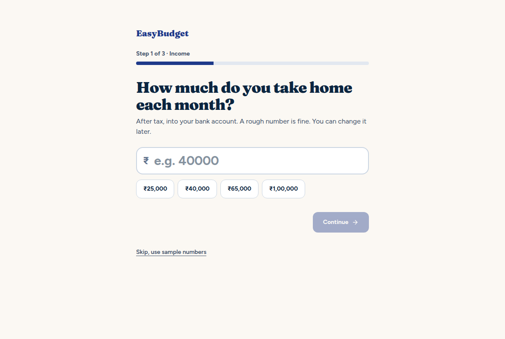
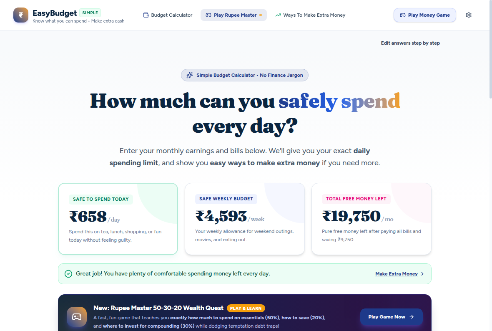

# EasyBudget

**A private, offline budget planner for Windows and Mac.** Answer three questions and it tells you one number: how much you can safely spend today.




## What it does

- **3-question setup**: income, monthly bills, savings goal. No account, no sign-up.
- **Instant limits**: safe spend per day, per week and per month, with a clear warning when bills plus savings exceed income.
- **Rupee Master**: a short 50-30-20 game that teaches budgeting by playing.
- **Ways to earn extra** (optional): live search of job portals for flexible side income, powered by Gemini with **your own free API key**.
- **Accessible**: works with a keyboard alone, labelled for screen readers, respects reduced-motion settings.

Amounts are in Indian rupees (₹). EasyBudget is a planning aid, not financial advice.

## Download

Get the installer for your system from the [Releases page](https://github.com/sambhavjuyal/easybudget/releases).

These builds are not code-signed yet (certificates cost money), so your system will warn you the first time:

- **Windows:** "Windows protected your PC" → click **More info** → **Run anyway**.
- **Mac:** right-click the app → **Open** → **Open**. If macOS says the app is damaged, run `xattr -cr /Applications/EasyBudget.app` in Terminal and open it again.

## Privacy and security

- Your numbers never leave your computer. They are stored locally and there is no analytics.
- The app window is locked down: it can only load its own files, all network requests from the page are blocked, and links open in your normal browser (https only).
- The optional Gemini key is entered in **Settings** and stored encrypted by your operating system (Windows DPAPI / macOS Keychain). It is only ever sent to Google when you run a job search.

## Run it from source

You need [Node.js](https://nodejs.org) 22 or newer.

```bash
npm install
npm run desktop     # build and open the desktop app
npm run dev         # develop in the browser (job search and Settings need the desktop app)
npm test            # money-math tests
npm run lint        # type-check
npm run dist        # build an installer for your own OS into release/
```

## Releasing

Push a version tag and GitHub Actions builds the Windows installer and both Mac installers (Intel and Apple Silicon) and attaches them to a GitHub Release:

```bash
git tag v1.0.0
git push origin v1.0.0
```

## Built with

React 19, TypeScript, Vite, Tailwind CSS 4 and Electron. Fonts (Fraunces, Figtree, JetBrains Mono) are bundled, so the app works fully offline.

## Contributing

Issues and pull requests are welcome. See [CONTRIBUTING.md](CONTRIBUTING.md).

## License

[MIT](LICENSE) © 2026 Sambhav Juyal
